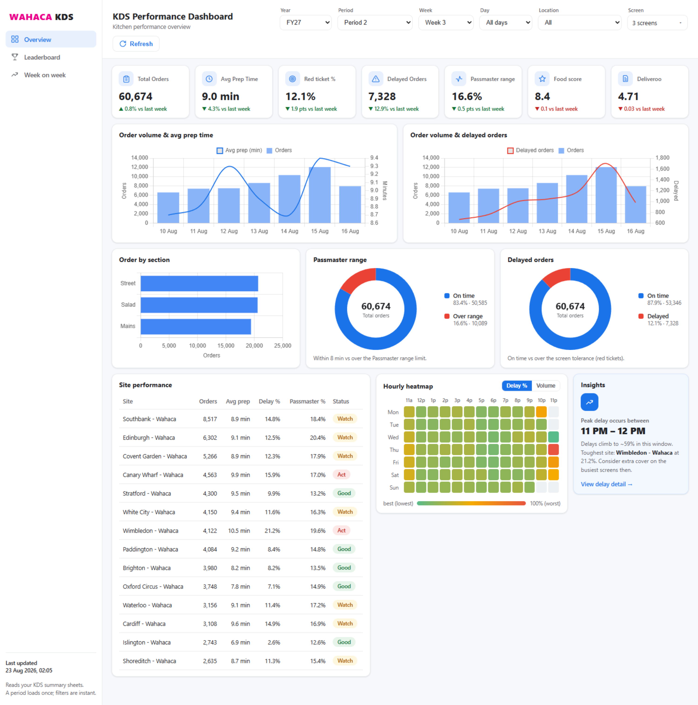
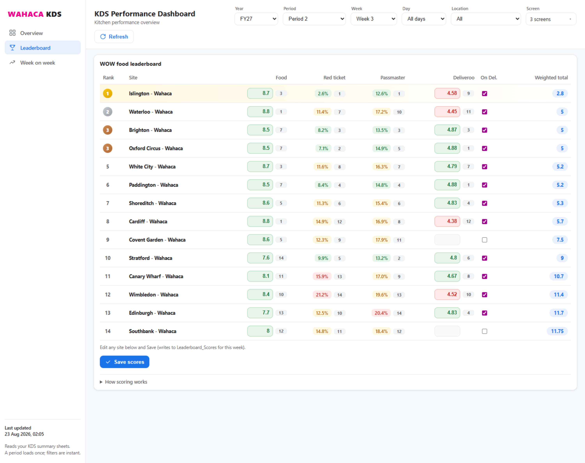
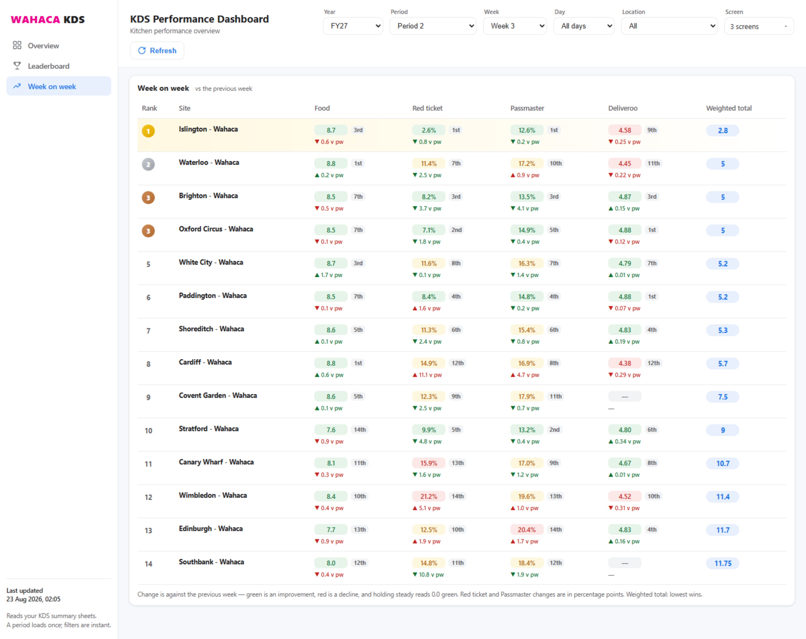
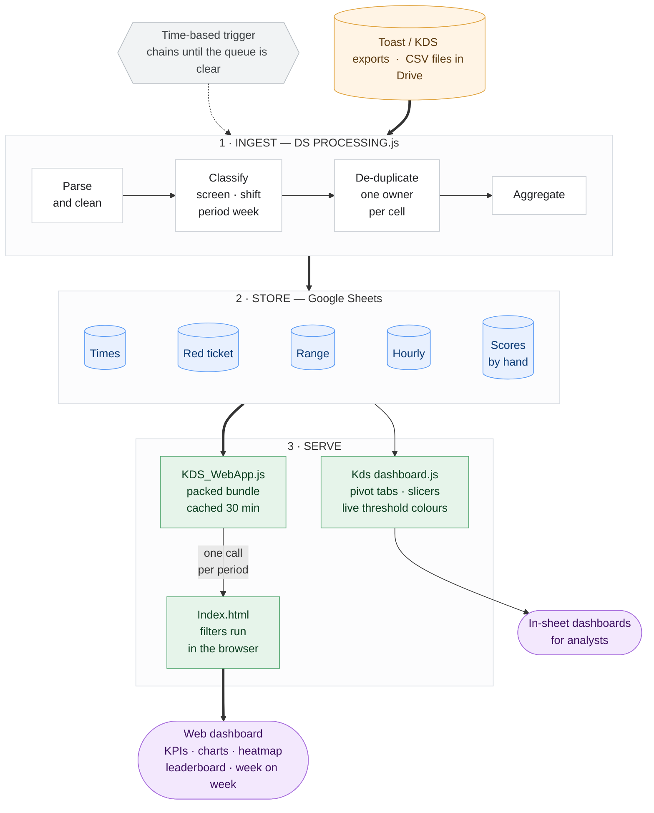
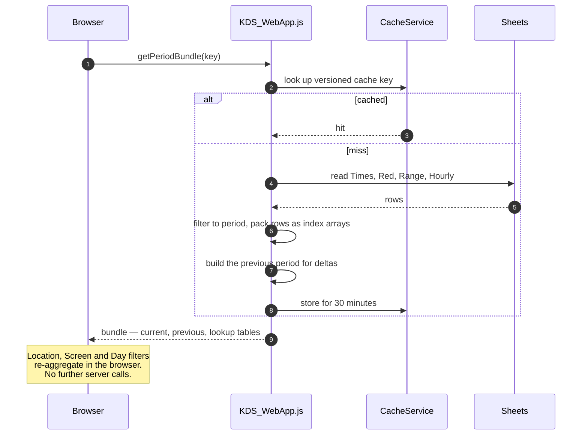

# Wahaca KDS Performance Dashboard

Kitchen performance reporting for the Wahaca restaurant estate, built on Google Apps Script.

Raw ticket exports from the kitchen display screens land in Google Drive as CSVs. This project turns
them into three things: clean summary tables, pivot dashboards inside the workbook, and a web
dashboard that ops managers actually open — KPI tiles, trend charts, an hourly delay heatmap, a
weighted site leaderboard, and a week-on-week movement view.

No servers, no build step, no dependencies to install. The whole thing runs inside Google's
infrastructure and is deployed with a single `clasp` command.

---

## The dashboard

### Overview

KPI tiles with week-on-week deltas, combo charts for volume against prep time and delays, section
mix, two rate donuts, a per-site table, an hourly delay heatmap and a generated insight.



### Leaderboard

Four metrics ranked and weighted into a single standing. Food and Deliveroo are editable inline for
the selected week and write straight back to the sheet.



### Week on week

Value, rank and movement for every metric. Green means the number improved, not that it went up — so
red tickets falling reads green.



---

## Contents

- [What it does](#what-it-does)
- [Architecture](#architecture)
- [The processing pipeline](#the-processing-pipeline)
- [The web app](#the-web-app)
- [Metrics and business rules](#metrics-and-business-rules)
- [Engineering notes](#engineering-notes)
- [Repository layout](#repository-layout)
- [Development](#development)
- [Work log](#work-log)

---

## What it does

**Ingests** Toast/KDS CSV exports from a Drive folder — incrementally, only touching files that are
new or changed since the last run.

**Cleans and classifies** every ticket: maps around 100 raw station names onto five kitchen screens,
derives prep duration, assigns a trading shift, and locates the date in a 13-period by 4-week retail
calendar.

**Aggregates** into three summary tables — prep times, red tickets (over screen tolerance), and
Passmaster range (how tightly a table's dishes land together).

**Presents** through two front ends: pivot dashboards written directly into the workbook for
analysts, and an HtmlService web app for everyone else.

---

## Architecture



### What a page load actually does

The interesting part is the request path. One call fetches a whole period; everything the user then
touches is served from memory in the browser.



Two design choices drive the whole shape of the system.

**Summaries live in their own spreadsheets, not the control workbook.** Times, Red Ticket and Range
each get a dedicated file. The control workbook stays small and quick to open, and no single file
runs into cell limits as the estate accumulates years of data.

**The browser does the filtering, not the server.** One server call ships an entire period; Location,
Screen and Day filters then run client-side against data already in memory. Changing a filter is
instant. Only changing the period, or hitting Refresh, goes back to the server.

---

## The processing pipeline

### Ingest

Files are tracked in a `ProcessedFiles` sheet by id, byte size and last-modified time. A file whose
three values are unchanged since a successful run is skipped entirely; a file that has been edited is
reprocessed and its previous rows removed first, so re-running is always safe.

### Cleaning

Rows are dropped when they are the office location, a `No print` station, a placeholder dash, fired
before the trading day starts, or missing a parseable fired/fulfilled timestamp. Both date parsers
handle US and UK ordering by inspecting the day component rather than assuming a locale.

### Classification

| Step | Rule |
|---|---|
| Screen | `StationMap` lookup, then keyword fallback (`bar`, `pass`, `salad`, `street`, `main`) |
| Duration | `Fulfilled Date` minus `Fired Date`, in minutes |
| Shift | Dinner if fired at or after the dinner cutoff (17:00), otherwise Lunch |
| Period week | Per-date lookup against a seeded retail calendar (13 periods by 4 weeks) |
| Fiscal year | Derived from the date — FY26 P1W1 = Mon 30 Jun 2025, each year 364 days |

Stations that match nothing are collected into `Unmapped_Stations` with counts, rather than silently
dropped — so a new screen appearing at a site surfaces as a report line instead of a hole in the data.

### De-duplication

Exports overlap: the same service often appears in two downloads. Naive de-duplication by day caused
whole days to vanish when a file containing a handful of bled-over tickets claimed the date and
blocked a fuller file.

The claim is therefore made at the **aggregation cell** — `Location | Date | Screen | Shift`. The
first file to cover a cell owns it, recorded in `DayIndex`. A partial file can only ever claim the
cells it actually contains, so it never blocks another file's screens or shifts on the same day.

### Runtime budget

Apps Script kills executions at a hard limit. Rather than being force-killed mid-write, a run measures
against its own budget, stops cleanly when it runs low, and schedules a continuation trigger a minute
later. A full rebuild of several years of exports chains across as many runs as it needs and finishes
unattended.

The same discipline applies to the heavier passes. The hourly heatmap rebuild will not overwrite a
good summary with a partial one if it runs out of time mid-pass, and the dashboard refresh defers
itself to the next run when there is not enough budget left to complete safely.

---

## The web app

### The bundle

`getPeriodBundle(key, force)` is the only data call the page makes. The key encodes the selection:

| Key | Meaning |
|---|---|
| `26:P9W1` | a single week |
| `26:period:P9` | a whole period |
| `26:quarter:Q2` | a quarter |
| `26:__ALL__` | a whole fiscal year |
| `__ALL__` | every year |

(The real separator is a pipe character.)

For a single week, rows are packed per date. For anything wider they are pre-aggregated by week
server-side, so a whole-year view ships roughly the same payload as a single week.

Payloads are arrays, not objects. Location and screen names are interned to integer indices and sent
once in a lookup table, so a row is `[locIdx, screenIdx, date, tickets, duration]` rather than five
repeated keys per row. Bundles are cached for 30 minutes under a version-stamped key; bumping
`CACHE_VER` invalidates every cached bundle at once when the shape changes.

The previous period is computed in the same call, which is what makes every week-on-week delta on the
page free — no second round trip.

### Leaderboard

Food and Deliveroo scores are entered by hand; red ticket and Passmaster come from KDS. Each of the
four columns is ranked independently, the ranks are weighted and summed, and the **lowest total
wins**.

| Metric | On Deliveroo | Not on Deliveroo |
|---|---|---|
| Food | 0.50 | 0.50 |
| Red ticket | 0.20 | 0.25 |
| Passmaster | 0.20 | 0.25 |
| Deliveroo | 0.10 | — |

Ranking rather than raw scores means four metrics on entirely different scales — a 1-10 food score, a
1-5 Deliveroo rating and two percentages — can be combined without normalising anything. Food carries
half the weight, so a site cannot offset poor food with fast timings.

Scores are stored in two shapes and read transparently: a weekly matrix (`Leaderboard_Scores`) and
per-period tabs. The reader also still understands an older vertical layout, so historical data
entered before the current structure keeps working.

---

## Metrics and business rules

**Red ticket %** — share of tickets that took longer than their screen's tolerance.

| Screen | Tolerance |
|---|---|
| Passmaster | 2 min |
| Bar | 5 min |
| Mains, Salad, Street | 15 min |

**Passmaster range %** — share of order groups where the gap between the first and last dish reaching
the pass exceeded 8 minutes. Tickets are grouped by check, then split into separate order groups when
more than a minute passes between fires, so a table that orders again later is not counted as one
badly-spread order.

**Average prep time** — volume-weighted mean duration. Bar and Passmaster are excluded, since they
measure something different from a cooking screen.

Rates are aggregated as `SUM(over) / SUM(total)`, never as a mean of per-row percentages — a plain
average would let a quiet Tuesday lunch weigh as heavily as a full Saturday service.

### Colour bands

| Metric | Green | Amber | Red |
|---|---|---|---|
| Red ticket | under 10% | 10-15% | 15% and above |
| Passmaster | under 15% | 15-20% | 20% and above |
| Food score | 7 and above | — | below 7 |
| Deliveroo | 4.65 and above | — | below 4.65 |

Bands are **absolute tolerances**, applied identically on the leaderboard and the overview. Colour
reflects whether a site is meeting its standard, never how it compares to the rest of the estate.

---

## Engineering notes

A few decisions worth calling out.

**Conditional formatting instead of static borders.** The pivot dashboards mark subtotal rows with
formula-driven conditional format rules rather than drawn borders. Pivot layouts shift whenever a
slicer changes or a group collapses; static borders drift out of place, formulas re-evaluate and stay
correct.

**Threshold cells drive dashboard colours.** Each pivot tab carries a small control block whose cells
are read live by the formatting formulas. Editing a threshold recolours the sheet immediately — no
script run, no redeploy.

**Fast path and full path are separate.** `refreshKdsDashboards()` rewrites data and re-points pivots
while leaving formatting, widths and slicers alone. `buildKdsDashboards()` recreates everything from
scratch. The fast path runs automatically after processing; the full rebuild is a deliberate act.

**Year-aware sort keys.** Period-week labels are stamped with their fiscal year and zero-padded
(`FY26 P08W1`), so a plain lexical sort is chronological, `P10` sorts after `P9`, and two years'
`P1W1` never merge into one bucket.

**Diagnostics are first-class.** Three read-only audits answer the questions that actually come up.
`auditMissingDays()` explains every gap and labels the likely cause — closure pattern, no file, or
covered but empty. `auditScreenCoverage()` distinguishes a genuine missing screen from a low-volume
one where blanks are normal. `checkCell()` proves a given site/date/screen is a true zero rather than
a processing failure.

---

## Repository layout

| File | Role |
|---|---|
| `DS PROCESSING.js` | Ingestion, cleaning, aggregation, scheduling, audits |
| `Kds dashboard.js` | Pivot dashboards inside the workbook |
| `KDS_WebApp.js` | Web app backend — bundle, cache, leaderboard, heatmap |
| `Index.html` | Front end — markup, styles and client logic in one file |
| `appsscript.json` | Apps Script manifest |

`Index.html` is deliberately a single file. HtmlService serves templates individually, and splitting
CSS and JS into separate includes buys separation at the cost of extra fetches and a more fragile
deploy. At this size, one file is the simpler trade.

---

## Development

Requires [`clasp`](https://github.com/google/clasp) and access to the Apps Script project.

```bash
npm install -g @google/clasp
clasp login
```

Copy `.clasp.json.example` to `.clasp.json` and fill in your script id, then:

```bash
clasp pull
```

```bash
clasp push
```

```bash
clasp deploy -i <deploymentId> -d "message"
```

`clasp push` alone updates the editor but **not** the live web app, which is pinned to a deployment
version. Publishing requires the `deploy` step with the existing deployment id; creating a new
deployment instead would hand out a different URL.

Bump `CONFIG.CACHE_VER` whenever the bundle shape changes, or clients will keep receiving stale
cached bundles for up to 30 minutes.

### Sheet-side setup

Run once from the **KDS Dashboard** menu in the workbook:

1. **Setup Workbook** — seeds Settings, StationMap and the period calendar
2. **Rebuild All** — reprocesses every export against the current calendar
3. **Build Dashboards** — creates the pivot tabs
4. **Rebuild Heatmap** — populates `Hourly_Summary`

---

## Work log

### Leaderboard colour bands — fixed

Red ticket and Passmaster were coloured by a site's **rank position**: best third green, middle
amber, bottom third red. The colour therefore said nothing about whether a site was actually meeting
its tolerance. With every site inside target the bottom third still rendered red, and a site at 14.9%
red tickets showed red purely for ranking last.

Replaced with absolute bands sourced from a single config block, and applied identically on the
overview's site table — which had been running its own tighter thresholds, so the same site could
read green on one page and red on another.

### Week on week — new view

A third tab showing value, rank and movement for all four leaderboard metrics plus the weighted
total. Built entirely from the bundle already in memory, so it costs no extra server call and opens
instantly.

Arrows encode **improvement, not direction**: red tickets falling shows green, because fewer red
tickets is better. Holding steady reads a green `0.0`. Every value sits in a fixed-width box so the
pills form one straight column down the table — the view goes out to site teams, and a table that
steps in and out with the length of each number is harder to scan.

---

## Licence

Private client project. Not licensed for redistribution.
